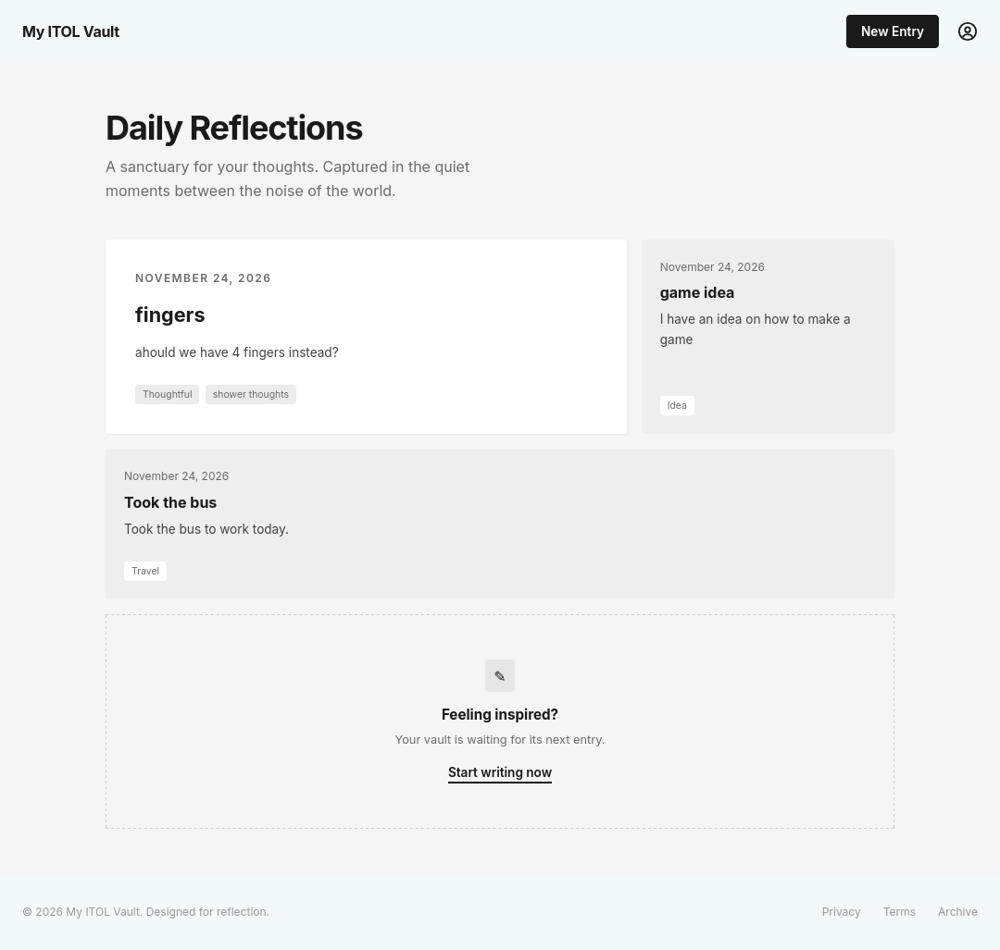

# My ITOL Vault
 
A multi-page digital diary built with HTML, CSS and vanilla JavaScript. Entries are saved in the browser with the Web Storage API (`localStorage`), so they're still there after you close the tab.
 
**Live demo:** https://hossain-ahm.github.io/my-itol-vault/
 

 
## Features
 
- **Three linked pages:** Home (5 most recent entries), New Entry (editor) and My Vault (every entry)
- **Persistent entries** saved to `localStorage` and shared across all pages
- **Tags:** pick one from the dropdown and add up to 3 custom tags with **+ Add Tag**
- **Validation:** an entry with an empty body won't save, and a blank title becomes "Untitled Reflection"
- **Responsive layout** built with CSS Grid and Flexbox, tested down to 320px wide
- **Empty state** on the Vault page when there are no entries yet
## Pages
 
| Page | File | What it does |
|---|---|---|
| Home | `index.html` | Shows the 5 most recent entries in an alternating wide/narrow grid |
| New Entry | `new-entry.html` | A form for the title, tags and the reflection itself |
| My Vault | `vault.html` | Every saved entry, newest first, as full-width rows |
 
## How it works
 
### Saving an entry
 
1. When **Save Entry** is clicked, `new-entry.js` reads the inputs with `.value` and builds an entry object:
```js
{ id: 1795532634550, title: "...", body: "...", tags: ["Idea"], date: "November 24, 2026" }
```
 
2. It loads the existing array from `localStorage`, adds the new entry to the **front** with `unshift()`, and saves the whole array back.
3. `localStorage` can only store strings, so the array is converted with `JSON.stringify()` before saving and converted back with `JSON.parse()` when reading.
### The "5 most recent entries" logic
 
New entries are added with `unshift()` instead of `push()`, so the array is always ordered **newest first**. Because of that, the home page only needs one line to get the latest five:
 
```js
const recentEntries = getEntries().slice(0, 5);
```
 
`.slice(0, 5)` returns a new array containing the items at index 0 to 4, which are the five newest. It doesn't change the saved data. If there are fewer than five entries, `slice` simply returns the ones there are. Each entry is then turned into a card with `document.createElement()` and added to the grid.
 
The Vault page uses the same code **without** `slice`, so every entry is shown.
 
### Shared code
 
`js/storage.js` holds the helper functions every page uses (`getEntries`, `saveEntries` and `shorten`). It is loaded before each page's own script. `getEntries` wraps `JSON.parse` in `try...catch`, so if the saved data is ever broken, the page shows an empty list instead of crashing.
 
### Safety
 
Cards are built with `textContent` rather than `innerHTML`, so anything a user types is shown as plain text and can't run as HTML or JavaScript.
 
## Project structure
 
```
my-itol-vault/
├── index.html
├── new-entry.html
├── vault.html
├── css/
│   └── styles.css
├── js/
│   ├── storage.js
│   ├── new-entry.js
│   ├── home.js
│   └── vault.js
└── screenshots/
    └── home.png
```
 
## Run it locally
 
1. Clone the repo:
```bash
git clone https://github.com/Hossain-ahm/my-itol-vault.git
```
 
2. Open the folder in VS Code and start **Live Server** on `index.html`.
Note: `localStorage` is stored separately for each browser and each address. Entries saved on `127.0.0.1:5500` won't appear on `localhost:5500` or on the live site.
 
## Built with
 
- HTML5
- CSS3 (Grid, Flexbox, custom properties)
- Vanilla JavaScript (DOM manipulation, Web Storage API)
## Reference
 
- [MDN: Window.localStorage](https://developer.mozilla.org/en-US/docs/Web/API/Window/localStorage)
- [MDN: Using the Web Storage API](https://developer.mozilla.org/en-US/docs/Web/API/Web_Storage_API/Using_the_Web_Storage_API)
 
